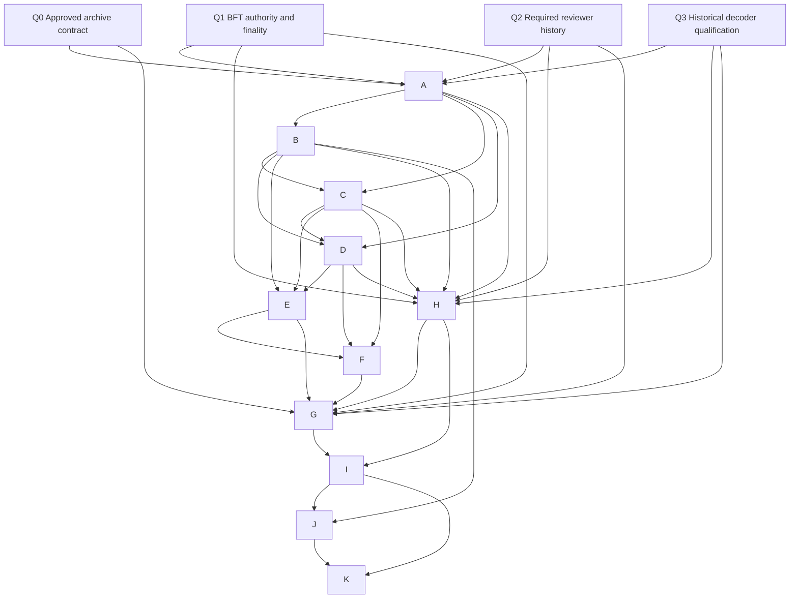

# Distributed Complete-Block Archiving and Safe Pruning

Date: **2026-11-03, America/New_York**. Task 7.24 architecture handoff. **INACTIVE PROPOSAL — NOT IMPLEMENTED.** This is an unnumbered future milestone recommendation; scheduling and protocol activation require separate decisions. See the [compression closeout](milestone-7-final-closeout-and-owner-decisions.md) for original-milestone and production verdicts.

## 1. Owner clarification and two independent verification properties

**MODEL A:** a complete finalized ZoidbergChain media block must contain the complete losslessly encoded media object and the canonical information needed to reconstruct the exact original bytes from that block alone. Its original-byte cryptographic hash must verify. It need not be retained by every node forever.

Nodes may fetch complete historical blocks from other participants and retain different subsets. No complete canonical media block may be replaced with a hash-only record, external URL, hosted original, reference to another media block or externally held fragments. Media-specific dictionaries/side information must be in the retrieved block. Reconstruction uses public historical normative codec software/specifications, not a proprietary server or mutable external data service. Original means accepted original bytes; admission-time text canonicalization is a separately documented byte-domain boundary, never a post-finality rewrite.

**Property A, media reconstruction, is self-contained. Property B, membership in the finalized canonical blockchain, requires authenticated chain evidence.** Headers, validator-set history, finality certificates/proofs and/or an explicitly approved authenticated checkpoint protocol may support B outside the complete media block. They cannot replace A's embedded payload. A standalone random block and a self-declared original hash cannot prove canonical finality. A block ID supplied by an untrusted archive is not a trust anchor.

Retaining complete original-media bytes is distinct from proving permanent future availability. Integrity commitments do not make deleted data recoverable. Periodic challenge success describes tested custody/retrievability over a bounded observation, not a proof of perpetual storage.

## 2. Proposed conceptual node roles

| Role | Responsibilities | Boundary |
| --- | --- | --- |
| Validator | Maintain authenticated consensus state and required current data; fully validate proposed complete media and admission evidence; participate in agreement | Archive custody never substitutes for validator verification at original block admission. Historical pruning only after a separately approved policy permits it |
| Partial archive | Retain assigned **complete** historical blocks, supporting proof material assigned by policy, and serve verifiable copies | A subset alone cannot produce complete independently verified state without correct commitments, consensus proofs and bootstrap procedures |
| Full archive | Retain all historical blocks and required verification history; support independent auditing/recovery | Full-archive coverage, operator diversity, capacity and backup responsibilities must be explicit and separately priced |

A physical operator may perform multiple roles. Multiple processes/node IDs under one operator do not count as independent custody. Validator status does not automatically establish archive independence, and archive membership does not grant consensus authority. No production role code is added.

## 3. Complete-block invariants and archive identity

1. Preserve the exact historical canonical block bytes and versioned block commitment. No re-encoding, lossy image conversion, signature stripping, certificate omission or change to historical size bounds during replication.
2. A complete block contains encoded media, codec/version and encoding identifiers, MIME, original and stored sizes, original-byte hash and all per-object reconstruction data. Decoder history is permanently specified and safely maintained. Each individual replica can reconstruct the entire media without another replica or block.
3. Preserve mandatory signed admission/review evidence in the canonical block. Supporting evidence not embedded by an approved historical protocol needs an explicit authenticated retention set. It cannot be presumed present, free, replaceable by a summary or irrelevant to independent history verification.
4. Retrieval identity must bind chain/network identity, historical protocol/block/encoding version, canonical block hash and the authenticated height/parent context. Exact wire fields, domain separation, signed length and proof packaging remain **unapproved**. Height alone or original-media hash alone is insufficient to identify canonical block membership.
5. Reject noncanonical bytes, wrong chain/version/height/hash, size violations, corrupt payloads, unknown codecs and invalid evidence. Distinguish invalid input from local decoder unavailability/resource failure; local failure never becomes acceptance.
6. Data transport, archive indexes and custody records are ancillary. No index entry, receipt or challenge proof replaces the complete block. Internal transfer chunking may be considered later only if receivers assemble/verify a complete block before custody credit; external fragments are not a MODEL A reconstruction dependency. No erasure-coding design is approved.

The inactive `canonical_v3` laboratory provides useful complete-record and decoder fixtures; it is not a production archive format approval. Existing finalized legacy history must remain decodable/verifiable under its own historical rules. Supporting header/authority/journal archives must not have circular dependencies on the pruned payload they authenticate.

## 4. Assignment, replication and custody principles

Use deterministic or independently verifiable assignments from authenticated membership/epoch inputs and canonical block identity. A later specification must fix the exact algorithm, capacity weighting, domain separation, epoch transition and reassignment rules. No archive's unilateral placement claim is authoritative. Candidate designs must be tested for membership grinding, concentrated placements and correlated failure domains before selection.

The **provisional target is three independently held complete copies per historical block**. Three node IDs do not imply three independent operators. Define operator control, shared owners/cloud accounts/infrastructure, geography/provider concentration, audit evidence, appeal and replacement rules. Identity verification cannot cryptographically prove all organizational independence; residual Sybil/correlation risk must be stated. Independent full archives may count only for blocks whose custody and independence meet the same policy; do not double-count one operator across roles, backups or virtual machines.

The future specification must distinguish target replication, minimum custody for pruning, repair triggers and fault assumptions. These are not approved consensus constants. Evaluate three independent retained copies **after** any proposed deletion, excluding the departing/pruning holder. A donor that is one of the three must first establish a replacement; a validator transferring its sole local copy ordinarily needs three other verified holders before deleting it. Additional full archives/backups are charged separately and never presumed available.

Custody credit should require transfer completion, durable storage/reopen, exact complete-byte verification, block-local reconstruction/hash checks, authenticated chain membership and independent retrieval observation. Signed acknowledgments bind the exact block/length, operator, assignment epoch and challenge/receipt freshness, but signatures alone cannot prove storage or future service. Define proof/receipt expiry, independent audit selection, replay prevention and concurrent-departure handling before use. Persist auditable custody transitions; do not erase accountability evidence with the payload.

Periodic unpredictable retrievability challenges and independent full-block retrievals should detect missing/corrupt/refused replicas. Define sampling coverage, deadlines, anti-outsourcing limits and how proof evidence is authenticated. An operator fetching data on demand can mimic custody; challenges do not prove unique physical disks. Avoid claiming a transport TLS session or receipt authenticates canonical chain membership.

## 5. Proposed safe-pruning state machine

This is a specification recommendation, not executable node behavior. Timers, quorums, finality semantics, authority and receipt formats remain unapproved.

| Proposed state | Required evidence / permitted transition |
| --- | --- |
| `REQUIRED_LOCAL` | Retain complete block and all consensus/application/current-data dependencies. Unfinalized or disputed blocks are ineligible for archival pruning |
| `FINALIZED_RETAINED` | Verify finality against the approved trusted anchor and historical authority; resolve retention age, current-state, reviewer-history and recovery dependencies under an approved policy |
| `TRANSFER_PENDING` | Assign independent holders under authenticated epoch/placement; send complete copies; retain local copy until all custody gates pass |
| `CUSTODY_VERIFIED` | Durably recorded fresh custody evidence plus independent retrieval/reconstruction of required other copies; supporting proof/history retention confirmed |
| `PRUNE_ELIGIBLE` | Revalidate at deletion time: approved policy/version, finalized membership, required post-delete independent replicas, fresh availability, no departure/repair/conflicting epoch, no local dependency or hold |
| `PRUNED` | Atomically journal authorized deletion and retained authenticated locator/proof metadata; preserve required consensus state/proofs and ability to request full blocks. A surviving index is not the media block |
| `DEGRADED_HOLD` | From any eligible state on underreplication, stale/failed audits, partition, uncertain independence/finality or missing proofs: stop further pruning; schedule authenticated repair. Already deleted bytes cannot be recreated from hashes |

Crash/restart must default to retain/hold when an authorization is incomplete, stale or ambiguous. Deletion and custody epochs need serialized rules preventing two holders from independently counting each other while both prune. A node never deletes required current consensus/reviewer state simply because old media is archived. The future policy must specify local dependency lifetimes and how old-version verification evidence remains reachable.

**Insufficient independent replicas halt further pruning.** A distributed node cannot instantly know all remote failures: policy must define freshness and failure-detection assumptions, consistent authorized epochs and partition behavior. Missing fresh evidence means retain/hold, not optimistic deletion. No claim is made of instant global knowledge or safety against arbitrary simultaneous malicious destruction after an audit.

On failed audit/departure, mark the assignment degraded, retain remaining copies, retrieve from authenticated survivors, establish a diverse replacement, verify its durable complete copy independently, then publish the new authorized epoch. Resume pruning only after the full post-delete custody requirement is reestablished. Graceful operators transfer before departure; sudden failure invokes repair without trusting the failed operator. If all copies are lost, report irrecoverable loss; neither hashes nor certificates repair absent media.

## 6. Threat model and required responses

| Risk | Required future control / test | Residual boundary |
| --- | --- | --- |
| Sybil identities / fake diversity | Operator-level policy, placement caps, independent audits; test many IDs controlled by one operator count once | Claimed identities and signatures do not prove independence |
| Correlated outages | Provider/region/power/control diversity; inject joint infrastructure failure | Different operators may still share infrastructure |
| Dishonest custody acknowledgments | Independent retrieval, reopen/durability checks, fresh randomized challenges; replay/empty-disk tests | A signed promise is not continuing possession |
| Censorship / refusal / selective service | Fetch alternate assigned peers, observer diversity, record failure, repair placement; targeted-request tests | Integrity does not force service; fallback may also fail |
| Network partitions | Bounded detection assumptions, stale-evidence expiry, pruning hold, heal/reconcile tests | Partitioned systems cannot assume global fresh availability |
| Storage concentration / placement loss | Measure control and capacity shares, verify assignments, rebalance, test skew/grinding/capacity exhaustion | Three colocated replicas may fail together |
| Reorganization / changing finality | Prune only under approved finality rules and trusted history; reject stale fork/epoch proofs; halt on finality conflict | A provisional fork is not finalized; violated finality assumptions need recovery/governance, not automatic history deletion |
| Fresh-node eclipse / malicious bootstrap | Independent anchor acquisition, canonical ancestry/authority/proof verification, multiple sources and complete replay tests | A snapshot digest from an archive alone is not trusted state |
| Missing historical review evidence | Preserve signed certificates and approved reviewer authority/journal proof history; test missing/forged cutoff and membership evidence | Media reconstruction alone cannot prove historical admission correctness |
| Free riding / incentives | Separate reward/penalty specification with auditable service; test selective custody, challenge outsourcing and collusion | No rewards, stake, slashing or payment policy is approved here |
| Replica deletion / churn / replacement races | Post-delete diversity checks, serialized custody epochs, repair reserve and crash/failure injection | Finite failures tested do not establish indefinite availability |
| Corrupt blocks / resource attacks | Bounded transport, canonical validation, strict historical decoding, original hash and membership checks | Local timeout/unavailable decoder must fail closed without asserting canonical invalidity |
| Dishonest validators at original admission | Keep original validator media/evidence verification and future BFT authority gates | Archive availability cannot repair an invalidly admitted canonical object |

Honest nodes can crash, lose disks, depart or serve slowly; malicious nodes can forge claims, withhold, collude, grind identities, replay old receipts and selectively answer audits. Define the tested adversary budget separately from consensus fault assumptions and operator failure domains. Do not import a validator fault threshold as an archive availability guarantee.

## 7. Required independent-node verification and bootstrap

A fresh verifier obtains its chain anchor through an independently approved trust procedure, not the archive being tested. It authenticates the canonical header/commitment path, historical validator-set transitions, finality certificates and any approved checkpoint boundaries. Then it fetches the expected complete block from an untrusted assigned archive, verifies canonical bytes/hash and historical format/limits, and reconstructs original bytes solely from the block using the historical decoder. It verifies exact original length and cryptographic hash against the **authenticated** block commitment. Supporting finality evidence can be separate; media payload data cannot.

Full semantic replay also checks required admission certificates, reviewer identities/eligibility, all required votes including negative/unsure votes, policy/cutoff and reviewer-history commitments under their historical rules. Where a future journal participates, preserve its full required proof/history dependencies and measured costs. Partial archives cannot bootstrap independent full state from isolated subsets or untrusted snapshots alone. Missing authority, history, proofs or decoder software produces an explicit failure/hold, not inferred validity.

Bootstrap must specify how a new node discovers authenticated archive assignments without live discovery being assumed implemented, acquires missing complete blocks and proof histories, verifies a full historical range, derives current state and resumes verification after interruption. A separately approved checkpoint may bound replay only under its explicit trust assumptions; do not label checkpoint trust as genesis-independent verification. Independent full archives support recovery/auditing but are not proprietary mandatory media servers.

## 8. Dependencies and existing laboratory boundaries

| Foundation | Present evidence | Gate for the future milestone |
| --- | --- | --- |
| Q0 — approved archive/protocol contract | This inactive proposal and historical complete-block/decoder fixtures | Owner-approved exact roles, invariants, limits, membership/custody/placement and versioning; roadmap reconciliation |
| Q1 — authenticated consensus/finality/validator authority | [7.17K static authority subset](milestone-7-bft-validator-authority-implementation.md), [7.17M G2 verifier](milestone-7-g2-genesis-verifier-implementation.md), model/signer laboratories | Future complete BFT execution, authenticated validator authority/genesis, historical transitions, durable finality and trusted anchors as required; existing incomplete subsets do not satisfy this gate |
| Q2 — historical admission/reviewer evidence | [7.17S isolated verification](milestone-7-review-journal-cryptographic-verification.md) and embedded media certificates | Specify and integrate required reviewer-history/journal authority, proof retention and cutoff semantics; explicitly justify any nondependency. Missing history must fail closed |
| Q3 — decoder/security/platform readiness | Strict worker/conformance and historical Windows/Linux experiments | Independent security review, supported-platform bounds and permanent historical decoder distribution; no qualification inferred from a benchmark |

Specifications may be prepared against named interfaces before foundations are implemented. Custody/pruning implementation, end-to-end acceptance and production release must wait for the foundations they depend on. Full future BFT/reviewer-history integration is accounted for here, not reported implemented and not imposed retroactively on original compression benchmarking.

## 9. Future milestone work packages

Every package below is **proposed, unstarted**. Acceptance artifacts must state versions, seeds/workloads, trusted anchors, operator topology, fault model, raw outcomes and limitations. No assigned milestone number conflicts with the existing roadmap.

### A. Canonical archive identity and authenticated retrieval specification

* **Purpose:** define exact retrieval identity, complete-block bytes and A/B verification interfaces.
* **Dependencies:** Q0 direction; Q1/Q2 authority/history interfaces; Q3 historical codec contract.
* **Security boundary:** untrusted transport/archives cannot supply trusted canonical identity; no media-data dependency outside the block.
* **Acceptance:** frozen cross-implementation vectors reject wrong network/version/height/hash, byte mutations, missing payloads and forged membership; a valid complete block reconstructs offline.
* **Deliverables:** versioned identity/retrieval specification, proof/anchor interface, canonical vectors, negative cases and compatibility matrix.
* **Consensus/protocol changes:** archive wire protocol **yes**; media/consensus format **conditional**, only if new commitments are needed and separately approved. Existing bytes remain frozen.

### B. Archive membership and operator-diversity policy

* **Purpose:** define authenticated archive entry/exit, operator control and independence evidence.
* **Dependencies:** A, Q0; Q1 only where chain-authorized membership is chosen.
* **Security boundary:** archive identity is not validator authority; multiple IDs do not multiply independent custody.
* **Acceptance:** fixtures with three IDs under one control count once; provider/control concentration is visible; stale membership/revocation and compromised-key cases cannot earn custody credit.
* **Deliverables:** membership lifecycle, diversity/appeal policy, failure-domain schema and Sybil test fixtures.
* **Consensus/protocol changes:** membership protocol **yes**; consensus **conditional** on on-chain registry, rewards or governance choice, presently unapproved.

### C. Deterministic replica assignment and placement

* **Purpose:** produce verifiable block-to-holder assignments with provisional three-operator replication and capacity constraints.
* **Dependencies:** A, B, authenticated membership/epoch inputs from the approved Q0/Q1 interface.
* **Security boundary:** prevent identity grinding, assignment ambiguity and correlated placement; do not confuse target with verified custody.
* **Acceptance:** independent implementations derive identical assignments; churn, skew, insufficient operators and adversarial identities produce defined hold/rebalance behavior rather than under-diverse pruning authorization.
* **Deliverables:** exact assignment specification, independent implementation vectors, distribution/concentration simulations and epoch transition rules.
* **Consensus/protocol changes:** assignment protocol **yes**; consensus **conditional** if assignments are consensus-authoritative rather than locally verified policy.

### D. Secure complete-block transfer and custody acknowledgment

* **Purpose:** transfer exact complete historical bytes and establish durable, independently checked custody.
* **Dependencies:** A, B, C; Q1 finalized identity; Q3 decoder support.
* **Security boundary:** receipt signatures alone are insufficient; transport success does not prove persistence or finality.
* **Acceptance:** interrupted/oversized/corrupt transfers, replayed receipts and crash-before-durability earn no credit; reopen and independent full retrieval match the expected block and original hash.
* **Deliverables:** bounded transfer/receipt specification, durable custody transitions, crash vectors and interoperability evidence.
* **Consensus/protocol changes:** transfer/custody protocol **yes**; consensus **conditional** if receipts affect chain state or incentives.

### E. Independent availability audits and retrievability challenges

* **Purpose:** detect absent, corrupt or selectively served replicas using unpredictable, independently observed checks.
* **Dependencies:** A, B, C, D; approved freshness/failure assumptions and Q1 clock/authority interfaces where applicable.
* **Security boundary:** finite challenges do not prove eternal storage, unique disks or operator independence; specify outsourcing/collusion limits.
* **Acceptance:** predeclared deleted-data, stale-replay, selective-refusal and outsourcing scenarios report detection rates/latency and false positives against published sample bounds; expired evidence never permits pruning.
* **Deliverables:** challenge/proof specification, observer policy, statistical coverage model, failure evidence and measured audit overhead.
* **Consensus/protocol changes:** audit protocol **yes**; consensus **conditional** for authoritative penalties/rewards or shared audit outcomes.

### F. Replica repair and operator replacement

* **Purpose:** restore complete-copy diversity after corruption, departure, outage or placement imbalance.
* **Dependencies:** C, D, E and authenticated membership changes from B.
* **Security boundary:** authenticate surviving copies; do not spread corrupt replicas or double-count a departing holder and replacement.
* **Acceptance:** graceful exit, sudden disk loss, adversarial donors and simultaneous replacement tests reestablish the approved post-repair target from valid survivors; no survivors yields explicit unrecoverable loss/hold.
* **Deliverables:** repair/rebalance/replacement procedures, epoch handover rules, fault traces and bandwidth/capacity measurements.
* **Consensus/protocol changes:** repair protocol **yes**; consensus **conditional** on authoritative assignments/custody commitments.

### G. Safe-pruning state machine

* **Purpose:** authorize only deletion that preserves required local dependencies and verified post-delete independent custody.
* **Dependencies:** A–F, H, Q0 approved policy, Q1 complete finalized authority, Q2 required historical review evidence, Q3 supported decoding.
* **Security boundary:** no premature deletion on stale custody, uncertain finality, partitions or concurrent departures; retain/hold on ambiguity.
* **Acceptance:** model/property checks and crash traces show no required-copy deletion before every approved gate; insufficient replicas or proof freshness halts pruning; two concurrent pruners cannot count each other to violate the post-delete minimum.
* **Deliverables:** exact state machine/invariants, durable authorization journal, race/crash/reorg test traces and operator recovery runbook.
* **Consensus/protocol changes:** custody/pruning coordination protocol **yes**; local deletion may be nonconsensus, but changing verification/retention obligations or chain-authoritative permissions needs separately approved consensus rules.

### H. New-node bootstrapping and historical verification

* **Purpose:** recover independently verified state and exact media from authenticated history and distributed complete blocks.
* **Dependencies:** A, D, Q1 approved anchors/authority/finality, Q2 required review history, Q3 historical decoders; B/C for assigned-source discovery.
* **Security boundary:** untrusted archives/snapshots cannot bootstrap their own authority; an approved checkpoint's trust limits must be explicit.
* **Acceptance:** a fresh node with only approved trust material verifies historical authority/transitions and a full declared history, reconstructs every requested original without cached media, rejects forged anchors/missing review evidence and resumes interrupted bootstrap.
* **Deliverables:** bootstrap/trust-anchor protocol, proof-history retention map, independent replay vectors and measured recovery procedure.
* **Consensus/protocol changes:** bootstrap/retrieval protocol **yes**; consensus/checkpoint changes **conditional**, requiring explicit approval rather than assumed implementation.

### I. Byzantine/adversarial fault testing

* **Purpose:** evaluate the composed archive, repair, bootstrap and pruning system under predeclared honest/malicious failures.
* **Dependencies:** A–H and implemented/qualified Q1/Q2/Q3 dependencies relevant to each end-to-end claim.
* **Security boundary:** finite laboratory results are scoped to operator/failure/topology assumptions, not an indefinite availability proof.
* **Acceptance:** publish all twelve tests below, seeded schedules, malicious cases and negative controls; any unauthorized prune, invalid-media acceptance or false finality acceptance fails release.
* **Deliverables:** reproducible fault harness, independent oracle, raw traces/results and residual-risk report.
* **Consensus/protocol changes:** harness **no**; discovered protocol fixes require separately reviewed amendments and reruns before acceptance.

### J. Three-year distributed-storage economics

* **Purpose:** compare validator/partial/full archive cost and aggregate network cost separately against full-retention Milestone 7 baselines.
* **Dependencies:** C–H workload/resource measurements, I tested churn/failure rates, B operator minimums; Q2 journal inclusion policy where applicable.
* **Security boundary:** no invented division-by-three savings, free proof history, unpaid incentives or zero repair/backup costs.
* **Acceptance:** reproducible 36-month simulations at 100/1,000/10,000 media blocks/day plus realistic measured retrieval/churn workloads; reconcile all replicas, proof/journal bytes, traffic, snapshots/backups, spare capacity and incentives with independent arithmetic and sensitivity checks.
* **Deliverables:** versioned workload/price assumptions, per-role and aggregate monthly ledgers/CSV, measured retrieval/repair costs, affordability misses and comparison report.
* **Consensus/protocol changes:** simulator **no**; selected incentive or retention policy **conditional**, separately approved and not activated by a cost report.

### K. Independent security and release-readiness audit

* **Purpose:** independently review the complete protocol/implementation, dependency qualification and release gates.
* **Dependencies:** A–J, resolved relevant Q0/Q1/Q2/Q3 gates, frozen release candidate and all critical findings addressed.
* **Security boundary:** the implementer's own tests and owner planning decisions do not constitute independent release approval.
* **Acceptance:** independent review verifies MODEL A closure, authority/trust assumptions, all twelve tests, operator-diversity limitations and economics; critical safety findings block release; activation requires explicit owner/protocol approval after review.
* **Deliverables:** security report, findings/remediation evidence, platform matrix, release checklist and a separate activation proposal.
* **Consensus/protocol changes:** audit **no**; any required amendment and eventual version/height activation **separately approved**, never automatic.

### Prerequisite graph

Arrows mean prerequisite → dependent. Q foundations may provide specification interfaces early; their complete approved implementations are required for the associated end-to-end gates. G deliberately depends on H to prevent pruning before bootstrap/recovery dependencies are defined and demonstrated. J consumes I's measured failure/churn results; K waits for both.

Transitive edges supply A–F to G and A–H to I. Independent deliverables can be scheduled after their prerequisites; this graph is not authorization to start them in Task 7.24.

## 10. Precise future acceptance tests

All are **NOT RUN / FUTURE**. Before testing, freeze the historical range, actual workload, seed/commitment for random selection, trusted anchors, operator-control map, topology, replica target, freshness/deadline policy and failure budget. Use an independent verifier and retain every failed trace. At least one full-history bootstrap complements random samples; do not cherry-pick available blocks.

| Test | Procedure | Required result |
| --- | --- | --- |
| 1. Untrusted assigned archive | Independently select random finalized heights/IDs across the declared range and fetch from assigned untrusted sources, including slow/refusing sources | Complete expected block retrieved under bounded policy, with authenticated identity; failures recorded and alternate sources exercised |
| 2. Block-local reconstruction | Remove cached originals, disable media URLs/other media-block access; decode the retrieved complete block with its normative historical decoder | Exact accepted original bytes reconstructed solely from block-local media data |
| 3. Original-byte commitment | Independently hash reconstructed bytes and compare size/hash with the authenticated canonical commitment | Exact match; corrupted content and matching self-declared but noncanonical replacement hashes rejected |
| 4. Finalized membership | Verify header ancestry, historical validator authority/transitions and finality proof against independently supplied trusted anchor; inject foreign/stale-fork proofs | Canonical membership accepted only with valid authority/proof; a random block's internal hash alone fails |
| 5. No central media dependency | Disable all uploader/proprietary media hosts and URL resolvers; use independent archives and historical decoders | Every valid tested block remains block-locally reconstructible; no valid format permits mandatory centralized media lookup |
| 6. Independent-operator failures | In the provisional three-copy laboratory, enumerate loss/refusal of each one and each pair of independent holders before repair, assuming the remaining holder is reachable; also test shared-provider outage and partitions | Recover exact originals from authenticated survivors within declared service bounds; report unsupported/total-loss cases. Same-operator IDs receive no extra failure tolerance |
| 7. Custody before prune | Inject crash/restart at every state transition, stale/forged receipts, concurrent departures, unresolved local dependencies and finality disputes | Zero required-copy deletions before the approved post-delete custody/finality/dependency gates; unknown state retains/holds |
| 8. Insufficient replicas | Drop independent custody below approved minimum, expire evidence and partition audit/membership sources | Further pruning halts under the declared freshness/detection assumptions; no optimistic deletion without fresh authorized evidence |
| 9. Repair | Delete/corrupt a replica, replace an operator and restore from surviving authenticated complete copies; include corrupt donor and no-survivor controls | Replacement independently reopens/reconstructs before custody credit; target restored before pruning resumes; total loss explicitly unrecoverable |
| 10. Fresh-node history | Start from approved trust material only, with empty media/state caches; retrieve/replay the declared full historical range and required review/authority proofs | Independently verify history, derive state and recover media; missing history or untrusted checkpoint fails closed |
| 11. Dishonest/corrupt archives | Supply wrong chain/version/block, truncated/oversized bytes, malicious codec streams, forged receipt/proof/reviewer history, selective responses and Sybil placements | No invalid original or unauthenticated canonical-membership claim accepted; local verification failure is not converted into validity |
| 12. Measured costs | Run realistic request locality, concurrency, churn, repair/rebalance and audit workloads; simulate all 36 months at three rates | Publish per-role and aggregate storage/traffic/CPU/cost ledgers with realistic measurements, assumptions, uncertainty and explicit affordability misses |

These tests establish only finite evidence under stated conditions. Even success in all twelve does not guarantee indefinite archival availability, arbitrary partition tolerance or survival of all holders' malicious destruction.

## 11. Economics boundary

Milestone 7's existing three-year models describe a node retaining full media history under stated assumptions and remain the baseline. Compare individual-node costs and aggregate-network costs in different ledgers. Aggregate accounting must enumerate complete replicas by distinct operator, full archives, current validator data, proof/authority/reviewer history, durable receipts/challenge evidence, indexes, snapshots, backup/restore, spare/repair capacity, retrieval/repair/rebalance/audit bandwidth and incentive/operational costs. Avoid double-counting a full archive already counted as a custodian; avoid omitting additional full archives or recovery copies.

Partial allocation may reduce one validator's historical media storage only after measurement; it does not imply a corresponding reduction in network-wide retained bytes or spend. Three independently held complete copies require replicated storage and service overhead. Distributing three copies does **not** divide total network costs by three. Node count, operator minimums, unequal capacity, correlations, churn, request patterns and any journal traffic must be modeled. No new cost-saving estimate is asserted by this proposal.

## 12. Explicitly unapproved protocol and release decisions

Unapproved items include the exact archive identity/wire/proof format; membership authority and operator-diversity enforcement; deterministic placement algorithm/seed and epoch governance; target versus minimum replicas and independence evidence; challenge scheme/observer selection/frequency/deadlines/freshness; custody receipts and durable acknowledgments; concurrent pruning authorization and retention lifetimes; repair reserves/placement and departure policy; new-node anchor/checkpoint trust and snapshot acceptance; historical validator/finality/reviewer proof retention; incentives/rewards/penalties/funding; transport security/discovery/rate limits; any new block commitments/version bounds; implementation platforms; activation height and rollback/recovery policy that preserves finalized history.

The owner's architectural clarification authorizes documenting this direction, not these exact protocol choices. Future BFT consensus, authenticated validator authority and required reviewer-history integration remain prerequisites for the relevant verification/pruning/release claims. No archive network, live peer discovery, block pruning, erasure coding, database migration, validator change or activation is implemented or begun here. The older roadmap's hash-only/off-chain media language is superseded for this proposal by the owner's explicit MODEL A contract; a separately authorized roadmap update must reconcile it.
